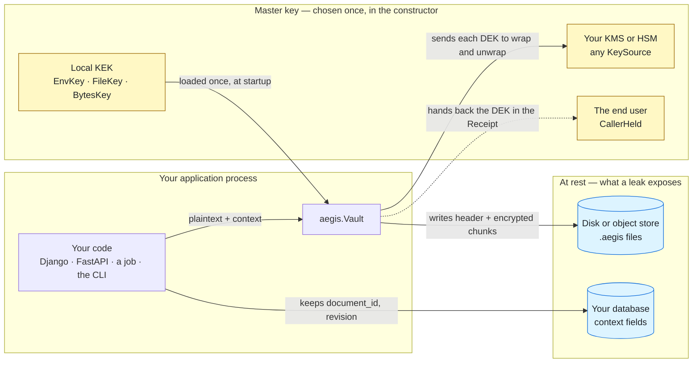
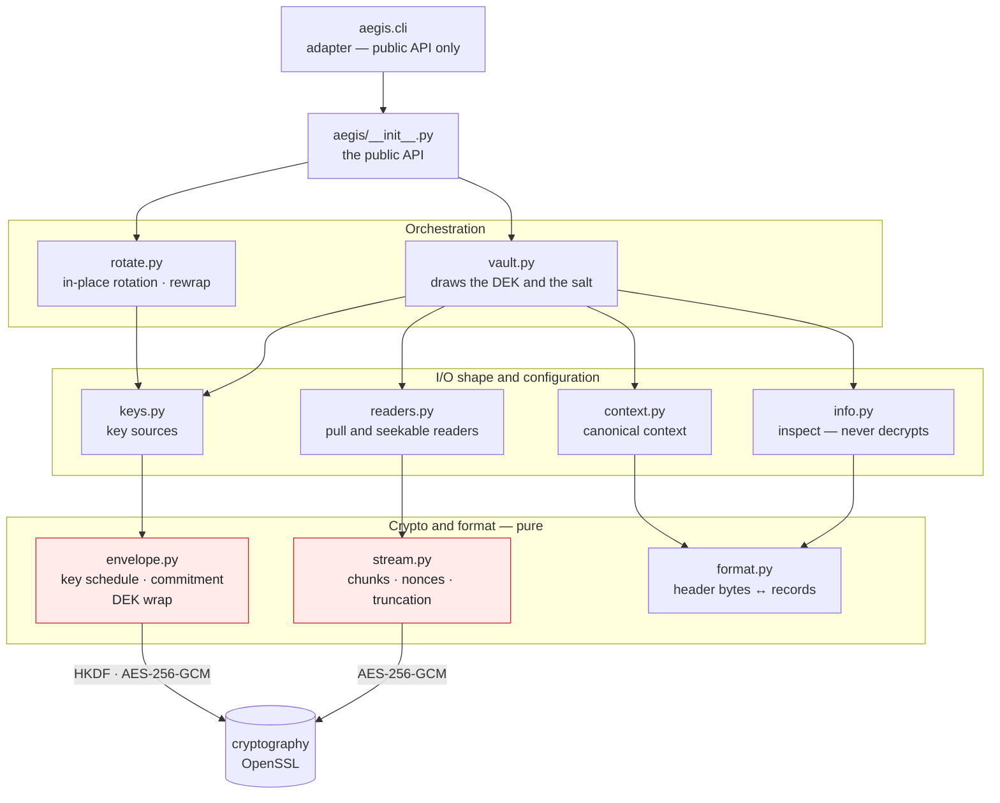
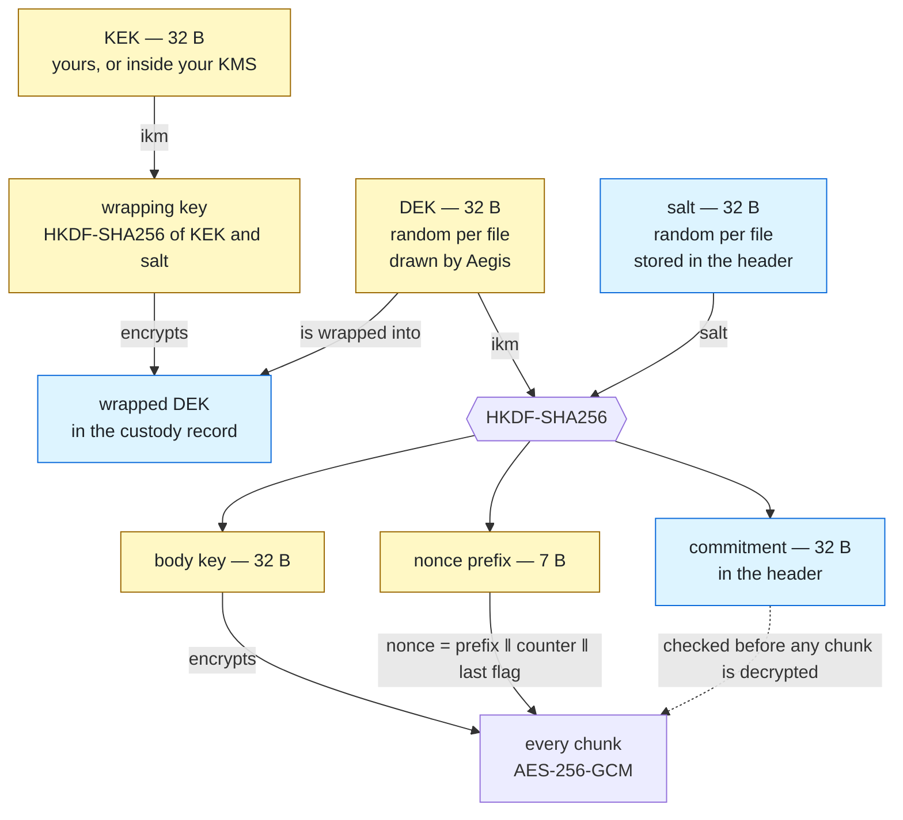
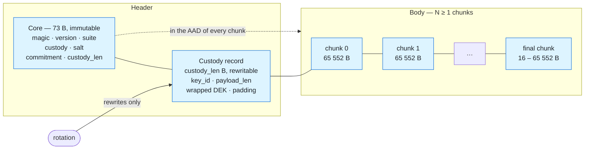
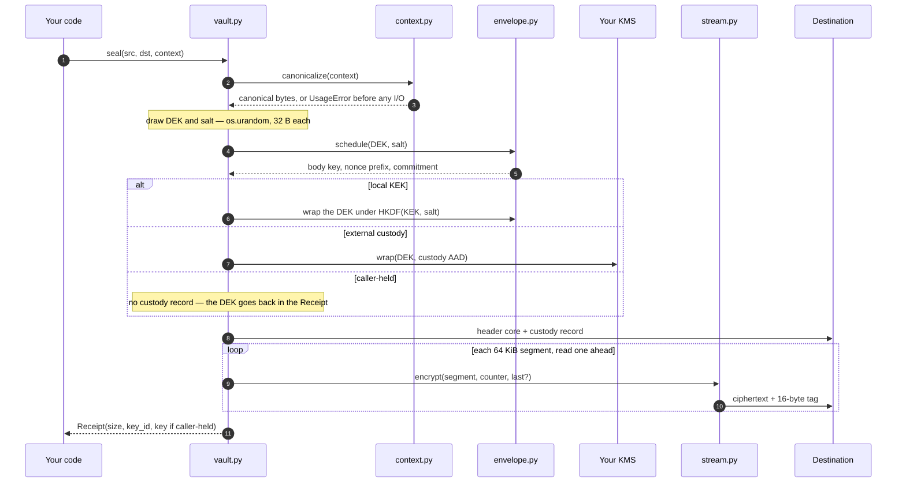
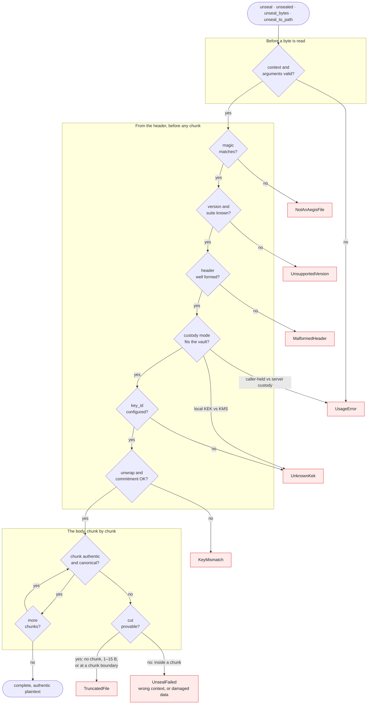
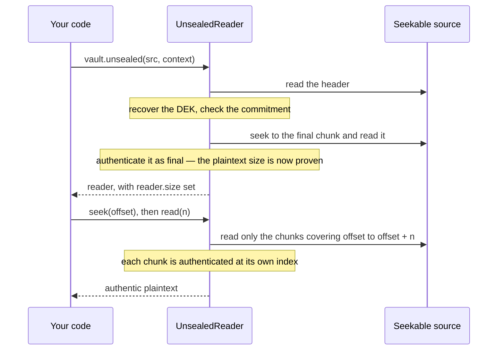
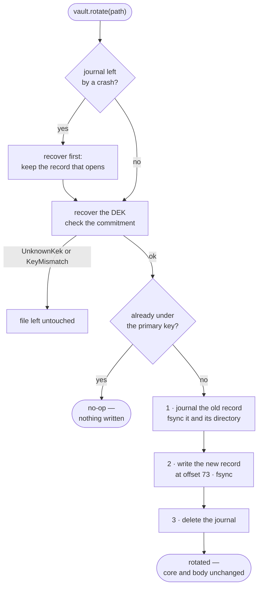

# How Aegis works, in diagrams

Pictures of what the other documents specify, for a reader who wants the mechanism before the
details. **Not normative:** where a diagram and a document disagree, the document wins —
[file-format.md](file-format.md) for bytes, [architecture.md](architecture.md) for code,
[security.md](security.md) for claims.

The diagrams are [Mermaid](https://mermaid.js.org). GitHub renders them in place; in VS Code,
use a Mermaid-capable Markdown preview. Colours mean the same thing in every figure:

| Colour | Means |
|---|---|
| amber | secret material — never stored in the clear |
| blue | stored at rest — safe to leak |
| red | where the cryptographic risk lives, or an error being raised |

---

## 1. The big picture

**Plaintext and keys meet only inside your process; what reaches storage is self-contained
ciphertext, and the master key is never stored next to it.**

- **What a leak shows.** Someone who steals the bucket and the database learns file sizes, file
  count, and which key id sealed each file — nothing about content. The context fields in your
  database are not secret: they bind, they do not encrypt.
- **Where the key ends up.** With a local KEK, the key sits in process memory. With a KMS, only
  per-file data keys ever do. With `CallerHeld`, Aegis keeps nothing.
- **What Aegis cannot fix.** A server compromised at runtime sees what the process sees, which is
  why Aegis does not claim to stop it
  ([security.md § 3](security.md#3-what-aegis-does-not-defend-against)).

## 2. Inside the package

**Every import points downward, the cryptographic risk sits in two small pure modules, and
randomness enters in exactly one place.**

- **Reading the arrows.** Every arrow reads "imports", and every one points down; nothing
  points up or sideways, and a test enforces it.
- **What is left out.** Only the main paths are drawn. `vault.py` and `rotate.py` also import the
  bottom layer directly, and `errors.py` — the leaf every module imports — is omitted.
- **Where randomness and the environment enter.** Only `vault.py` calls `os.urandom` — two calls
  per seal — and only `keys.py` reads the environment and key files.
- **Why the vectors need no mocks.** The two red modules receive every key, salt and nonce as a
  parameter, so the frozen vectors can pin their output without patching anything
  ([architecture.md § 4](architecture.md#4-the-purity-boundary-randomness-lives-at-the-edges)).

## 3. From one master key to every chunk

**One master key protects any number of files, but every file gets its own data key and salt —
and therefore its own body key, nonce prefix and key commitment.**

- **The custody modes change only the left branch.** It is drawn for a local KEK. A KMS performs
  its own wrap there instead; with `CallerHeld` there is no wrap, and the user keeps the DEK.
- **Rotation changes only the wrapped DEK.** The DEK, the salt, and everything derived from them
  stay as they are, which is why file bodies are never touched.
- **What the commitment buys.** A header opens under exactly one DEK, and a wrong key fails
  before the body: `KeyMismatch`, not a vague error
  ([file-format.md § 3](file-format.md#3-key-hierarchy)).

## 4. A sealed file

**Everything rotation must change sits in one rewritable record; everything else is fixed at
sealing time and authenticated by every chunk.**

- **Size.** The custody record is 66 bytes for a local KEK, absent for caller-held files, and up
  to 4 096 bytes for a KMS wrap. Each chunk adds 16 bytes of tag to its 64 KiB of plaintext.
- **What the nonce detects.** Every chunk's nonce carries its position and a final-chunk flag, so
  reordering, dropping or appending chunks fails to authenticate, and so does a body that ends
  early ([file-format.md § 4](file-format.md#4-chunks)).

## 5. Sealing, step by step

**The context is checked before any I/O, the header is written before any plaintext is read,
and then the body streams through one segment at a time.**

- **Memory.** Exactly one segment is in flight at any time, which is what keeps memory constant
  for a file of any size.
- **Reading ahead.** The writer must know whether a segment is the last before encrypting it, so
  it reads one segment ahead, and it never rewinds: the destination may be a pipe or a socket.
- **The pull form.** `vault.sealed(src)` performs the same steps lazily, as the reader is read
  ([file-format.md § 6.1](file-format.md#61-sealing)).

## 6. Unsealing: every check, in order

**Each failure is reported by the first check that can prove it: argument errors before a byte
is read, key errors before a chunk is decrypted, and truncation only where it is provable.**

- **What `UnsealFailed` still means.** By the time the body is read, the key has passed the
  commitment check. So `UnsealFailed` means a wrong context or damaged data — never a wrong key.
- **The order of checks.** It is what makes errors actionable: `UnknownKek` means "you are missing
  a key", not "your file is broken".
- **Seekable readers.** `unsealed()` over a seekable source runs the truncation check at open,
  on the final chunk, before returning any byte
  ([file-format.md § 6.2](file-format.md#62-unsealing)).

## 7. Reading at an offset

**A seekable reader authenticates the final chunk before it returns anything, so it knows the
exact size and that nothing was cut; afterwards it decrypts only the chunks a read covers.**

- **Where this matters.** HTTP Range requests, media players and libraries that seek (`zipfile`,
  Pillow, PDF readers) work without decrypting the whole file.
- **Opening costs one chunk.** One extra chunk decryption buys the guarantee that a truncated file
  never yields a single byte.
- **A non-seekable source** — a socket, an S3 body — gets a forward-only reader instead, with the
  streaming trust boundary of [security.md § 6](security.md#6-the-streaming-trust-boundary).

## 8. Rotating a key

**Rotation rewrites one small record per file and never reads the body; a journal makes a power
cut mid-write recoverable.**

- **Cost.** It is a few `fsync`s per file, so it scales with the number of files, never with their
  size.
- **Object stores.** S3, GCS and Azure Blob cannot rewrite part of an object, so there
  `vault.rewrap(src, dst)` streams a new copy instead: a new header, and the body bytes copied
  verbatim, never decrypted.
- **What rotation does not undo.** Copies made before rotation — backups, object versions — still
  open with the old key ([security.md § 5.2](security.md#52-what-rotation-does-and-does-not-do)).
